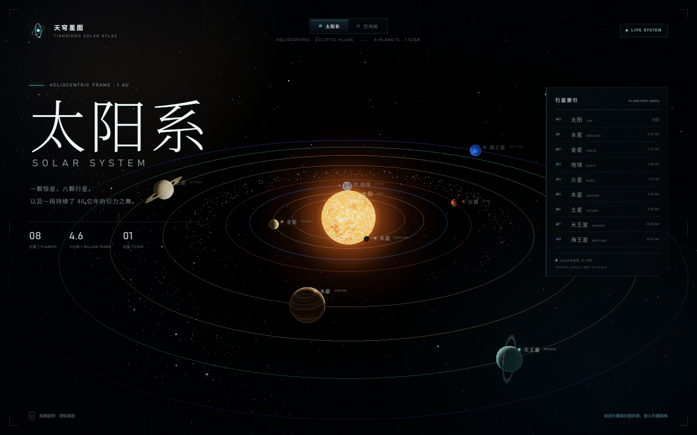
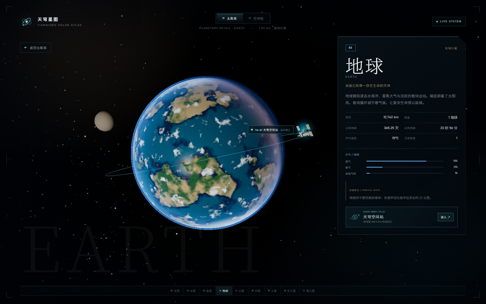

# 天穹星图 · 太阳系与空间站





一座完全由代码构建的可交互 3D 太阳系。打开页面首先进入 **日心太阳系视角**，点击任意行星或右侧索引，即可进入该天体的 3D 档案；地球档案中停泊着「天穹空间站」，可进一步进入空间站内部视角。

场景不使用外部模型或贴图：太阳、八大行星、土星环、卫星、小行星带、空间站与地球大气全部由 Three.js 程序化生成，并通过实时 PBR 光照、阴影、泛光与自定义着色器呈现。

## 启动

```powershell
npm install
npm start
```

浏览器打开 **http://127.0.0.1:8137**。

也可以使用任意静态服务器从项目根目录启动。页面依赖 `node_modules/three` 的本地 ES Module 路径，因此不能直接双击 `index.html` 通过 `file://` 打开。

## 两种视图

### 太阳系

- 页面默认进入 **日心太阳系视角**。
- 拖拽旋转、滚轮 / 双指缩放。
- 点击行星、场景标签或右侧行星索引，进入行星 3D 档案。
- 太阳、水星、金星、地球、火星、木星、土星、天王星、海王星均可选择。
- 右上角实时行星索引包含天体编号、英文名与轨道距离。

### 空间站

- 顶部居中的 **太阳系 / 空间站** 开关可随时切换。
- 地球档案中会显示「天穹空间站」轨道标记与「进入」按钮。
- 空间站视图保留完整交互：全景、核心舱、实验舱、太阳翼、机械臂、场景热点、自动巡航与太阳翼追踪。
- 右上角「任务档案」可查看空间站任务参数。

## 行星档案

每个天体都有独立的 3D 模型与详细资料：

- **太阳**：实时扰动的等离子体表面、日冕、G2V 恒星数据
- **水星**：撞击坑、铁质核心与极端温差
- **金星**：硫酸云层、逆行自转与失控温室效应
- **地球**：程序化大陆、云层、城市灯光、大气散射，以及近地轨道上的天穹空间站
- **火星**：锈红地表、极冠、水手号峡谷与两颗卫星
- **木星**：带状云层、大红斑与四颗伽利略卫星
- **土星**：冰粒环系、极区六边形与土卫六
- **天王星**：近乎躺倒的自转轴与暗环
- **海王星**：深蓝大气、暗斑与超音速风暴

详情面板包含直径、质量、公转周期、自转周期、温度、卫星数量、大气组成与轨道笔记。

## 技术栈

- Three.js r169（本地依赖，无 CDN）
- WebGL2 / PBR / Directional Light Shadow / PMREM 环境反射
- UnrealBloomPass + OutputPass 后处理
- 程序化 CanvasTexture：行星表面、太阳、空间站蒙皮、金箔、太阳电池、标识
- 自定义 GLSL：太阳等离子体、行星光照、土星环、地球大气、星空
- 响应式 HUD：桌面端右侧行星索引，移动端底部横向天体条

## 项目结构

```text
index.html             页面结构、太阳系与空间站 HUD
styles.css             视觉系统、响应式布局、动效
src/main.js            渲染器、模式切换、相机、后期、交互、加载流程
src/solarSystem.js     太阳系场景、行星数据、轨道、环系、卫星、空间站轨道
src/planetTextures.js  行星表面程序化贴图
src/station.js         空间站程序化几何
src/environment.js     空间站地球、星空、光照与大气
src/materials.js       空间站 PBR 材质
src/textures.js        Canvas 程序化贴图
server.mjs             无依赖静态服务器
scripts/               本地视觉与交互校验脚本（可选）
```

## 视觉校验

在已安装 Playwright Core 与 Edge 的环境中：

```powershell
node scripts/final-test.cjs
node scripts/solar-mobile.cjs
node scripts/planets.cjs
```

截图输出到 `shots/`。
